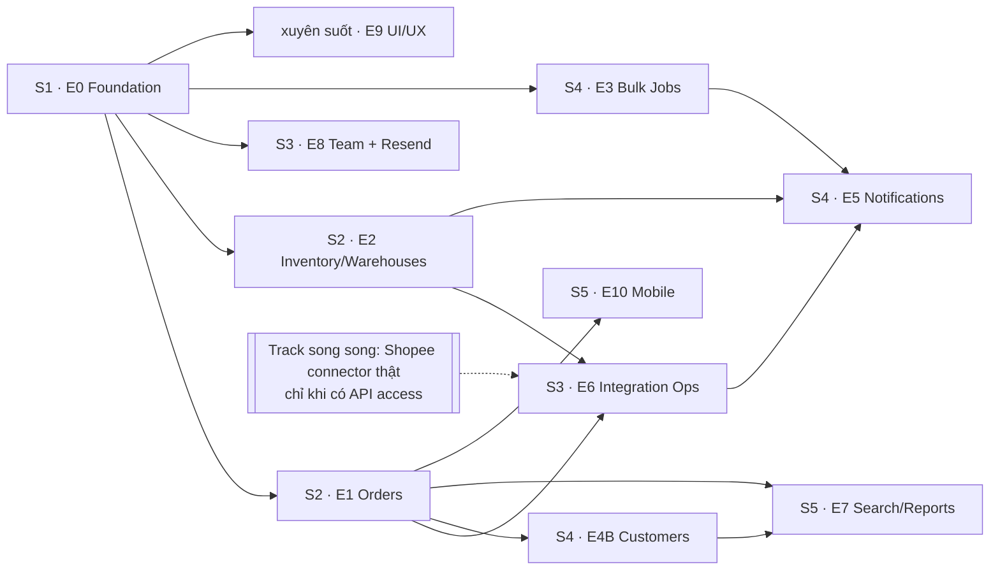

# Kế hoạch triển khai: Hoàn thiện & mở rộng OMS

> **Chỉ lập kế hoạch, không viết code.** Tài liệu này biến [PLAN-feature-enhancement.md](PLAN-feature-enhancement.md) (brainstorm + gap analysis) thành danh sách task có thể giao việc, kiểm chứng và rollback. Chi tiết "vì sao" và sơ đồ workflow xem tài liệu gốc.

## 1. Quyết định đã chốt

| # | Chủ đề | Quyết định | Tác động vào kế hoạch |
|---|---|---|---|
| D1 | Customers | **Suy ra từ đơn hàng** (E4B) | Bảng `customers` upsert trong transaction tạo đơn |
| D2 | Khóa định danh khách | `(channel, external_customer_id)`; thiếu thì dùng **SĐT chuẩn hóa**; thiếu cả hai thì **không tạo customer**, đơn vẫn lưu tên khách | Cần thêm trường `externalCustomerId` vào DTO đơn/webhook và `customer_id` nullable trên `orders` |
| D3 | Notifications | **Polling 30s**, không SSE | SWR `refreshInterval`; gỡ `socket.io-client` ở cuối S4 |
| D4 | Pagination | Breaking change `{ data, meta }` với **giai đoạn chuyển tiếp ngắn**: có `?page`/`?limit` → định dạng mới, không có → mảng cũ; web + mobile chuyển sang mới; **gỡ nhánh cũ ở PR cuối sprint 2** | Task bắt buộc "gỡ nhánh legacy" kèm điều kiện |
| D5 | Fulfillment | **Chỉ theo dõi trạng thái từ marketplace** | **Bỏ** `tracking_number`, `carrier`, pick-pack, quét barcode khỏi E1/E10. Giữ `cancel_reason` và in packing slip hàng loạt |
| D6 | Email invite | **Resend**. Gửi lỗi → vẫn tạo invite, lưu `EMAIL_FAILED`, owner có "Gửi lại" + "Sao chép link"; dev không có key → ghi link ra log | Thêm trạng thái email cho invite; link được tạo lại (rotate token) khi gửi lại/sao chép |
| D7 | Ưu tiên S3/S4 | **Không lùi S4** nếu có quyền Shopee API | Connector thật chạy **track song song** (xem mục 3), không chiếm chỗ của Bulk/Notifications |

## 2. Giả định và ràng buộc

- 1–2 kỹ sư full-stack; mỗi sprint 2 tuần. Nếu chỉ có 1 người, S5 là phần đầu tiên cắt giảm (E7/E10 dời sang đợt sau).
- Mỗi task = 1 PR, có test, có thể revert độc lập. Migration chỉ thêm cột/bảng (additive); không đổi hoặc xóa cột trong cùng sprint.
- Migration tenant schema phải chạy qua cơ chế sync schema hiện có ([SyncTenantSchemas](../backend/src/database/migrations/1706604000000-SyncTenantSchemas.ts), [tenants.service.ts](../backend/src/tenants/tenants.service.ts)) và có test "schema mới = schema đã migrate".
- Chưa có quyền Shopee Partner API → mọi thứ liên quan connector dùng **fixture**; không trình bày mock là tích hợp thật.

## 3. Dependency graph



**Track song song Shopee (D7):** nếu có quyền API, một kỹ sư chuyển sang làm `implementation-plan-production-pilot.md` Phase 3 trên nhánh riêng sau khi E6 hoàn tất. S4 vẫn giữ nguyên phạm vi. Nếu chỉ có 1 người, **chấp nhận connector thật trễ**, không cắt S4.

## 4. Phân công agent

| Phạm vi | Agent chính | Skill tham chiếu |
|---|---|---|
| NestJS, DB, queue, error envelope | `backend-specialist` | `api-patterns`, `database-design`, `nestjs-patterns` |
| Next.js/React, SWR, error boundary | `frontend-specialist` | `frontend-design`, `frontend-patterns`, `react-frontend` |
| UI/UX system (E9) | `frontend-specialist` + `ui-ux-pro-max` | `tailwind-patterns` |
| Mobile (E10) | `mobile-developer` | `mobile-design` |
| Test, e2e, concurrency | `test-engineer` | `testing-patterns`, `tdd-workflow`, `webapp-testing` |
| Security (rate limit, token, PII) | `security-auditor` | `vulnerability-scanner` |
| Điều phối các PR đa lĩnh vực | `orchestrator` | — |

---

## 5. Sprint 1 — Foundation + dọn tính năng giả (Tuần 1–2) · P0

**Mục tiêu:** Không còn tính năng giả; lỗi không làm trắng trang; contract API có nền chung.

### S1.1 Backend foundation

| ID | Task | Files dự kiến | Input → Output → Verify |
|---|---|---|---|
| S1.1.1 | Error envelope chuẩn `{ statusCode, code, message, details?, requestId }` + bảng error code (`ORDER_DUPLICATE`, `STOCK_INSUFFICIENT`, `WAREHOUSE_IN_USE`, …) | `common/filters/http-exception.filter.ts`, mới `common/errors/error-codes.ts` | Exception bất kỳ → envelope; **test:** 400/401/403/404/409/500 đều đúng shape, 500 không lộ stack |
| S1.1.2 | `ParseUUIDPipe` cho mọi param `:id`, `:masterSkuId`, `:warehouseId`, `:inviteId` | tất cả `*.controller.ts` | UUID sai → 400 `INVALID_UUID`, không phải 500 từ Postgres; **test e2e** |
| S1.1.3 | `PaginationQueryDto` + `Paginated<T>` + helper truy vấn (limit mặc định 25, tối đa 100) | mới `common/pagination/*` | Unit test giới hạn limit, page âm, limit = 0 |
| S1.1.4 | Rate limiting `@nestjs/throttler`: auth 5/phút/IP; API 100/phút/user | `app.module.ts`, `auth.controller.ts` | Request thứ 6 login → 429 + `Retry-After`; test |
| S1.1.5 | `enableShutdownHooks`, đóng Bull + DB pool, `/health/ready` trả 503 khi đang tắt | `main.ts`, `health/health.service.ts` | Gửi SIGTERM → ready=503 trước khi tắt; test |
| S1.1.6 | `statement_timeout` cho kết nối API (đề xuất 5s, cấu hình qua env), worker dùng giá trị riêng | `database/database.module.ts`, `data-source.ts` | Query chậm bị cắt với lỗi có mã `QUERY_TIMEOUT`; test |
| S1.1.7 | Thêm `PUT /warehouses/:id`, `DELETE /warehouses/:id` (soft delete, chặn khi còn tồn/đơn mở → 409 `WAREHOUSE_IN_USE`) | `warehouses/*` | Test: sửa, xóa kho trống, xóa kho còn tồn bị chặn |
| S1.1.8 | `GET /orders` hỗ trợ `status`, `externalOrderId`, `channelAccountId` (chưa phân trang — làm ở S2) | `orders.controller.ts`, `orders.service.ts` | Test lọc từng tham số và tổ hợp; tham số sai kiểu → 400 |

### S1.2 Frontend foundation

| ID | Task | Files dự kiến | Verify |
|---|---|---|---|
| S1.2.1 | Thêm `app/error.tsx`, `app/global-error.tsx`, `app/not-found.tsx`, `app/loading.tsx`; gắn `ErrorBoundary` cho chart/print | `app/*`, [ErrorBoundary.tsx](../frontend/components/ErrorBoundary.tsx) | Component ném lỗi → chỉ vùng đó hiện fallback, điều hướng vẫn hoạt động |
| S1.2.2 | **Refresh single-flight** trong `api.ts`: một promise dùng chung, request 401 xếp hàng; refresh lỗi → logout đúng 1 lần | [lib/api.ts](../frontend/lib/api.ts) | **Test:** 3 request 401 đồng thời → đúng 1 lần gọi `/auth/refresh`; refresh fail → 1 lần redirect |
| S1.2.3 | Hook `usePaginatedQuery` đồng bộ filter/page với URL; tận dụng `useTenantScopedSWR` | mới `hooks/usePaginatedQuery.ts` | Reload giữ nguyên filter; đổi tenant không lộ dữ liệu cũ |
| S1.2.4 | `lib/features.ts` (cờ tĩnh theo env) + guard route: truy cập trực tiếp URL của tính năng bị ẩn → trang "Sắp có", không crash | mới `lib/features.ts`, `components/layout/FeatureGate.tsx` | Customers, Notifications, Reports, Bulk Operations bị gate; Sidebar/GlobalSearch ẩn mục tương ứng |
| S1.2.5 | Gỡ khỏi UI các thành công giả: bulk import, bulk delete product/customer, bulk print "coming soon", GlobalSearch mock | `bulk-operations/page.tsx`, `products/page.tsx`, `customers/page.tsx`, `orders/page.tsx`, `GlobalSearch.tsx` | `grep` không còn `toast.success` đứng sau `// TODO` |
| S1.2.6 | Xóa `fetch` trần: `useCustomers`/`useNotifications` bị cờ tắt, đánh dấu `@deprecated` tới khi viết lại ở S4 | hooks | Không còn request tới `/api/customers` hay `/api/notifications` |
| S1.2.7 | Dọn thư mục rỗng `app/auth`, `app/dashboard` | `frontend/app/*` | Build sạch |
| S1.2.8 | Warehouses edit/delete dùng endpoint mới; trang chi tiết kho: tạm hiển thị dữ liệu thật có sẵn, ẩn phần mock (bản đầy đủ ở S2) | `warehouses/[id]/page.tsx`, `useWarehouses.ts` | Không còn số liệu mock |

### Test-first (S1)
Viết trước: test envelope + UUID (BE), test refresh lock (FE), test warehouse delete bị chặn (BE). Xác nhận chúng **fail đúng lý do** rồi mới code.

### Exit criteria S1
- [ ] Ném lỗi giả lập trong 1 page không làm trắng app
- [ ] UUID sai → 400; 3 request 401 song song → 1 lần refresh
- [ ] Không route nào hiển thị dữ liệu giả hoặc báo thành công giả
- [ ] Sửa/xóa kho chạy đầu-cuối

### Rollback S1
Code-only (cờ tính năng, filter, controller mới). Không có migration → revert PR là đủ.

---

## 6. Sprint 2 — Orders + Inventory (Tuần 3–4) · P0

### S2.1 Orders (E1, đã bỏ tracking/carrier/pick-pack theo D5)

| ID | Task | Files dự kiến | Verify |
|---|---|---|---|
| S2.1.1 | **Migration** thêm `cancel_reason` (nullable), index `(status, created_at DESC)`, `(external_order_id)`, `(channel_account_id)` | `migrations/*-OrdersIndexesCancelReason.ts` + spec | Test schema mới = schema đã migrate; có `down` |
| S2.1.2 | `GET /orders` phân trang + `q`, `from`, `to`, `sort`; **chuyển tiếp D4**: có `?page`/`?limit` → `{data, meta:{page,limit,total}}`, không có → mảng cũ | `orders.controller.ts`, `orders.service.ts` | Test cả hai nhánh; limit > 100 bị chặn; **seed 10.000 đơn: p95 < 300ms** |
| S2.1.3 | `GET /orders/:id/timeline` (gộp `audit_logs` + `inventory_movements`, sắp xếp theo thời gian) | `orders.service.ts` | Test thứ tự và nội dung |
| S2.1.4 | Trả `allowedTransitions` trong chi tiết đơn (dùng `ORDER_STATUS_TRANSITIONS` hiện có) | `orders.service.ts` | Test mọi trạng thái |
| S2.1.5 | `POST /orders/bulk-status` `{ids[], status, reason?}`: **mỗi đơn một transaction**, trả `{succeeded[], failed[{id,code,message}]}`; tối đa 100 id; có `Idempotency-Key` | mới DTO + service | **Test:** lô 10 đơn có 2 đơn sai trạng thái → 8 thành công, 2 lỗi, tồn kho đúng; gọi lại cùng key → cùng kết quả |
| S2.1.6 | `PUT /orders/:id/status` nhận `reason` (bắt buộc khi hủy) và trả 409 `ORDER_STATE_CONFLICT` khi trạng thái đã đổi | `update-order-status.dto.ts` | Test hủy thiếu lý do → 400 |
| S2.1.7 | FE: filter bar đồng bộ URL, server pagination, nút chuyển trạng thái chỉ hiện transition hợp lệ, modal hủy bắt buộc lý do, timeline | `app/orders/page.tsx`, `orders/[id]/page.tsx`, `useOrders.ts`, `types/orders.ts` | Playwright: lọc → chọn → confirm hàng loạt → thấy kết quả từng phần |
| S2.1.8 | FE: bulk action hiển thị "N thành công, M lỗi + lý do"; optimistic update có rollback; 409 → refetch + toast giải thích | `BulkActionBar.tsx` | Mô phỏng API lỗi → UI rollback |
| S2.1.9 | FE: in packing slip hàng loạt (tối đa 50 đơn/PDF), render theo chunk để không treo tab | [PackingSlip.tsx](../frontend/components/print/PackingSlip.tsx), `orders/page.tsx` | In 50 đơn không treo; > 50 bị chặn có thông báo |
| S2.1.10 | **Mobile chuyển sang định dạng phân trang mới** (bắt buộc cùng sprint theo D4) | `mobile/src/services/orders.service.ts`, `store/slices/ordersSlice.ts` | Unit test slice; chạy thử danh sách + load thêm |
| S2.1.11 | **Gỡ nhánh trả mảng legacy** của `GET /orders` — *chỉ khi* web + mobile đã merge và `grep` không còn caller không có `page` | `orders.controller.ts` | Test cũ cập nhật; không caller nào gọi không phân trang |

> **Điều kiện chặn S2.1.11:** S2.1.7 và S2.1.10 đã merge. Nếu mobile chưa kịp release lên store, giữ nhánh legacy thêm 1 sprint và ghi hạn gỡ vào backlog.

### S2.2 Inventory & Warehouses (E2)

| ID | Task | Files dự kiến | Verify |
|---|---|---|---|
| S2.2.1 | `GET /inventory` phân trang + `lowStock`, `warehouseId`, trả kèm `ats = max(0, on_hand − reserved − safety_stock)` | `inventory.service.ts`, `inventory.controller.ts` | Test công thức, biên bằng 0 |
| S2.2.2 | `GET /inventory/movements` (ledger có phân trang, lọc SKU/kho/loại/ngày) | `inventory.service.ts` | Test; index phù hợp |
| S2.2.3 | `POST /inventory/transfer` (một transaction: khóa 2 hàng theo thứ tự id cố định để tránh deadlock; 2 movement; audit; outbox) | `inventory.service.ts`, DTO | **Test:** kho đích inactive → rollback; chuyển vượt tồn → 409 `STOCK_INSUFFICIENT`; 2 transfer ngược chiều song song không deadlock |
| S2.2.4 | `GET /warehouses/:id/summary` (số SKU, tổng on-hand, giá trị tồn) | `warehouses.service.ts` | Test số liệu |
| S2.2.5 | API cấu hình `safety_stock` theo SKU/kho | `inventory.controller.ts` | Test validate âm / không phải số |
| S2.2.6 | Idempotency cho `adjust`/`transfer` (`Idempotency-Key`, lưu 24 giờ) | mới `common/idempotency/*` | Gọi lặp cùng key → không tạo movement thứ hai |
| S2.2.7 | FE: cột ATS + tooltip công thức; tab Movements; modal Transfer; trang kho dùng `summary` thật; trang product detail hiển thị phân bổ tồn theo kho (thay "coming soon") | `inventory/page.tsx`, `warehouses/[id]/page.tsx`, `products/[id]/page.tsx`, `ProductInventory.tsx` | Không còn mock; 4 trạng thái UI đủ |
| S2.2.8 | **Concurrency test:** 20 `reserve` song song cho SKU còn 10 → đúng 10 thành công, tồn không âm | `inventory.service.spec.ts` / integration | Chạy trên Postgres thật |

### Exit criteria S2
- [ ] Mọi filter trên UI Orders có tác dụng ở server; 10k đơn vẫn mượt
- [ ] Bulk status không bao giờ báo thành công cho đơn lỗi
- [ ] ATS khớp ledger; không mock ở warehouse/product detail
- [ ] Web + mobile cùng dùng định dạng phân trang mới; nhánh legacy được gỡ hoặc có hạn gỡ

### Rollback S2
Migration chỉ thêm cột/index → có `down`. Endpoint mới đứng riêng, tắt được bằng revert. Rủi ro lớn nhất là đổi định dạng danh sách → đã giảm bằng giai đoạn chuyển tiếp (D4).

---

## 7. Sprint 3 — Integration Ops + Team/Resend (Tuần 5–6) · P0/P1

### S3.1 Integration Ops (E6) — làm bằng fixture

| ID | Task | Files dự kiến | Verify |
|---|---|---|---|
| S3.1.1 | Inbox worker đọc `webhook_inbox` bằng `FOR UPDATE SKIP LOCKED`, timeout theo message, không throw ra vòng lặp | mới `webhooks/inbox.processor.ts` | **Test:** 2 worker chạy cùng lúc không xử lý trùng; poison message → `DEAD` |
| S3.1.2 | Outbox publisher có backoff (1m, 5m, 30m, 2h) và trạng thái `DEAD` sau lần cuối | mới `jobs/processors/outbox-publisher.processor.ts` | Test: lỗi 3 lần rồi thành công → `published_at` đúng một lần |
| S3.1.3 | Webhook SKU chưa map → tạo exception `UNMAPPED_SKU` (payload đã redact) thay vì chỉ trả `skipped` | [webhooks.service.ts](../backend/src/webhooks/webhooks.service.ts) | Test: không còn nhánh "skipped" mà không có exception |
| S3.1.4 | Thay `error.message.includes('already exists')` bằng lỗi có mã `ORDER_DUPLICATE` (dùng envelope S1.1.1) | `webhooks.service.ts`, `orders.service.ts` | Test đổi message không làm hỏng nhận diện trùng |
| S3.1.5 | **Retry thật:** `POST /integration-exceptions/:id/retry` đẩy lại sự kiện gốc vào queue; thành công → `RESOLVED`, thất bại → `OPEN` + `retry_count++`; chống bấm lặp khi đang `RETRYING` | [integration-operations.service.ts](../backend/src/integration-operations/integration-operations.service.ts) | Test cả hai nhánh; retry song song → chỉ một job |
| S3.1.6 | Hành động "Map SKU ngay" từ exception: tạo mapping rồi tự retry | `integration-operations.controller.ts`, `channel-mappings.service.ts` | Test end-to-end bằng fixture |
| S3.1.7 | Fake adapter + contract test fixture: webhook trùng, sai thứ tự, thiếu mapping, publisher lỗi | mới `integrations/testing/*` | Chạy trong CI không cần mạng |
| S3.1.8 | FE Exceptions console: lọc loại/mức độ/tuổi, xem payload, Retry/Resolve/Map SKU, lịch sử retry; Channels: health theo account | `exceptions/page.tsx`, `channels/page.tsx`, `useIntegrationOperations.ts` | Playwright: webhook thiếu mapping → thấy exception → Map SKU → đơn được tạo |
| S3.1.9 | Reconciliation giữ `BLOCKED_CONTRACT`, nhưng UI nói rõ "chờ cấu hình Shopee Partner" thay vì trông như lỗi | `channels/page.tsx` | Không còn trạng thái gây hiểu nhầm |

### S3.2 Team & Resend (E8, D6)

| ID | Task | Files dự kiến | Verify |
|---|---|---|---|
| S3.2.1 | **Migration:** `tenant_invites` thêm `email_status` (`PENDING`/`SENT`/`EMAIL_FAILED`), `email_sent_at`, `email_error`; thêm `users.full_name` (nullable) | `migrations/*-InviteEmailStatusUserFullName.ts` | Có `down`; test migration |
| S3.2.2 | `MailService` bọc Resend: cấu hình `RESEND_API_KEY`, `MAIL_FROM`, `APP_URL`; **không có key → ghi link ra log (chỉ non-production)**; production thiếu key → fail khi khởi động, không âm thầm bỏ qua | mới `mail/*`, `config/*` | Test: có key (mock SDK), không key (dev), production thiếu key |
| S3.2.3 | Tạo invite → gửi mail; lỗi gửi **không rollback invite**: lưu `EMAIL_FAILED`+`email_error` (không chứa key/PII thừa) | [tenant-members.service.ts](../backend/src/tenants/tenant-members.service.ts) | Test lỗi Resend → invite vẫn tồn tại, status đúng |
| S3.2.4 | `POST /tenants/:id/invites/:inviteId/resend` (owner): **rotate token**, gia hạn 7 ngày, gửi lại; trả link **một lần** cho owner để "Sao chép link" | `tenant-members.controller.ts` | Test: token cũ vô hiệu sau resend; role khác owner → 403; rate limit theo tenant |
| S3.2.5 | **Bảo mật token:** lưu **hash** token thay vì plaintext; migration băm token pending hiện có; list invite **không bao giờ trả token**; `POST /invites/accept` so sánh theo hash | `tenant-invite.entity.ts`, `tenant-members.service.ts` | Test: accept bằng token đúng/sai/hết hạn/đã dùng; response list không có token |
| S3.2.6 | Điền `fullName` thật thay vì email (sửa TODO ở service); cập nhật profile | `tenant-members.service.ts`, `update-profile.dto.ts` | Test mapping |
| S3.2.7 | FE: trang `/invites/accept`; trong `TeamManagement` hiện trạng thái email, nút **Gửi lại** và **Sao chép link**; hook `usePermission(action)` ẩn/disable nút theo role | `app/invites/accept/page.tsx`, [TeamManagement.tsx](../frontend/components/settings/TeamManagement.tsx), mới `hooks/usePermission.ts` | Playwright: invite → lỗi email giả lập → sao chép link → accept thành công |

### Exit criteria S3
- [x] Không còn đơn bị "skipped" âm thầm; mọi exception có đường xử lý trên UI
- [x] Retry chạy lại tác vụ thật; worker restart giữa chừng không tạo đơn/outbox trùng
- [x] Invite gửi qua Resend; lỗi gửi không mất invite; token không bao giờ lộ qua API list

### Rollback S3
Worker bật/tắt bằng env flag (`INBOX_WORKER_ENABLED`, `OUTBOX_PUBLISHER_ENABLED`). Migration băm token **không đảo ngược được** → trước khi chạy: backup `tenant_invites` và ghi vào runbook; rollback = hủy invite pending và gửi lại.

---

## 8. Sprint 4 — Bulk Jobs + Notifications + Customers (Tuần 7–8) · P1

> Theo D7, S4 **giữ nguyên phạm vi** dù có Shopee API hay không.

### S4.1 Bulk Jobs (E3)

| ID | Task | Files dự kiến | Verify |
|---|---|---|---|
| S4.1.1 | **Migration** bảng `bulk_jobs` (tenant schema): `type`, `status`, `total`, `processed`, `failed`, `error_report`, `idempotency_key`, `started_at` | migration + `tenants.service.ts` bootstrap | Test schema mới = đã migrate |
| S4.1.2 | `POST /bulk-jobs` (dry-run trả `valid/invalid[{row,field,message}]`), `GET /bulk-jobs/:id`, `GET /bulk-jobs/:id/errors.csv`; kiểm tenant sở hữu job (không lặp lại lỗi IDOR) | mới `bulk-jobs/*` | Test cross-tenant → 404 |
| S4.1.3 | Worker theo batch 100 dòng, mỗi batch một transaction; idempotent theo `(jobId, rowNumber)`; job kẹt > 15 phút → `FAILED` + exception | mới `bulk-jobs/bulk-jobs.processor.ts` | Test: restart giữa chừng → tiếp tục, không trùng |
| S4.1.4 | Loại job: `PRODUCT_IMPORT` (upsert theo SKU), `INVENTORY_IMPORT` (đặt tồn theo SKU+kho, ghi movement), `PRODUCT_DELETE` (soft, chặn SKU còn reserved) | `bulk-jobs/handlers/*` | Test từng loại + SKU còn reserved |
| S4.1.5 | Giới hạn 5.000 dòng / 5MB; kiểm quota gói qua [tenant-limits.service.ts](../backend/src/tenants/tenant-limits.service.ts) | `bulk-jobs/*` | Test vượt giới hạn → 413/422 có mã rõ ràng |
| S4.1.6 | FE wizard: Upload → Preview (dòng lỗi tô đỏ) → Progress → Kết quả (+ tải file lỗi); parse CSV theo chunk/Web Worker | `bulk-operations/page.tsx`, [CSVUploader.tsx](../frontend/components/bulk/CSVUploader.tsx), [useCSVImport.ts](../frontend/hooks/useCSVImport.ts) | CSV có BOM, tiếng Việt, dòng trống, SKU trùng trong file, thiếu cột; 5.000 dòng không treo UI |
| S4.1.7 | Bật lại cờ Bulk Operations; bulk delete product dùng `PRODUCT_DELETE` thật | `products/page.tsx`, `lib/features.ts` | Không còn TODO bulk |

### S4.2 Notifications — polling 30s (E5, D3)

| ID | Task | Files dự kiến | Verify |
|---|---|---|---|
| S4.2.1 | **Migration** bảng `notifications` (`type`, `severity`, `title`, `body`, `link`, `dedupe_key` UNIQUE, `read_at`, `user_id` nullable) | migration + bootstrap | Test unique dedupe |
| S4.2.2 | `NotificationsService.create` (dedupe) + `GET /notifications?unread=&page=`, `POST /:id/read`, `POST /read-all` | mới `notifications/*` | Test dedupe, phân quyền theo tenant/user |
| S4.2.3 | Producers: `LOW_STOCK` (từ S2.2), `INTEGRATION_EXCEPTION` (S3.1), `BULK_JOB_DONE` (S4.1); `dedupe_key` dạng `LOW_STOCK:{sku}:{warehouse}:{date}` | các service tương ứng | Test: cùng điều kiện trong ngày → đúng 1 notification |
| S4.2.4 | FE hook mới dùng `api.ts` + `useTenantScopedSWR` với `refreshInterval: 30000`, **tạm dừng khi tab ẩn**, optimistic mark-read | `useNotifications.ts`, `notifications/page.tsx`, header bell | Test: tab ẩn không poll; đổi tenant không lộ thông báo cũ |
| S4.2.5 | Gỡ `socket.io-client` khỏi `frontend/package.json` (không có gateway backend) | `package.json` | Build sạch, không còn import |

### S4.3 Customers suy ra từ đơn (E4B, D1–D2)

| ID | Task | Files dự kiến | Verify |
|---|---|---|---|
| S4.3.1 | **Migration** bảng `customers` (`channel`, `external_customer_id`, `phone_normalized`, `name`, `first_order_at`, `last_order_at`, `order_count`, `total_spent`), unique `(channel, external_customer_id)` và unique `phone_normalized` có điều kiện; `orders.customer_id` nullable + index | migration + bootstrap | Test schema |
| S4.3.2 | Thêm `externalCustomerId` (optional) vào `CreateOrderDto`, `WebhookOrderDto` | `orders/dto/create-order.dto.ts`, `webhooks/dto/webhook-order.dto.ts` | Test validate |
| S4.3.3 | Upsert customer **trong cùng transaction** tạo đơn theo quy tắc D2; thiếu cả mã và SĐT → bỏ qua customer, đơn vẫn lưu | [orders.service.ts](../backend/src/orders/orders.service.ts) | **Test 3 nhánh:** có buyer id; chỉ có SĐT (chuẩn hóa `+84`/`0`); không có gì |
| S4.3.4 | Hàm chuẩn hóa SĐT (VN) dùng chung BE; SĐT dạng bị che (`*****123`) **không** được coi là định danh | mới `common/utils/phone.ts` | Test số bị mask, khoảng trắng, mã vùng |
| S4.3.5 | `GET /customers?q=&page=`, `GET /customers/:id`, `GET /orders?customerId=` (sửa việc lấy toàn bộ đơn ở trang chi tiết) | mới `customers/*`, `orders.service.ts` | Test; PII che một phần với role không phải owner/manager |
| S4.3.6 | FE viết lại hook `useCustomers` dùng `api.ts` (read-only), bỏ create/update thủ công hoặc ẩn; trang chi tiết dùng `?customerId=`; bật lại cờ Customers | `useCustomers.ts`, `customers/*`, `CustomerForm.tsx` | Không còn `fetch` trần; không TODO |
| S4.3.7 | Backfill đơn cũ (script idempotent chạy theo batch/tenant, chạy được lại) | mới `scripts/backfill-customers.ts` | Chạy 2 lần → kết quả như nhau |

### Exit criteria S4
- [ ] Import 5.000 dòng không treo UI; mọi dòng lỗi có lý do
- [ ] Low stock và exception mới sinh đúng 1 notification
- [ ] Customers hiển thị dữ liệu thật; không tạo trùng khi cùng buyer/SĐT
- [ ] Không còn `fetch` trần, không còn `socket.io-client`

### Rollback S4
Bảng mới (additive) → tắt bằng cờ + revert. Backfill customers chỉ ghi vào bảng mới, không sửa `orders` ngoài cột `customer_id` nullable.

---

## 9. Sprint 5 — Search/Reports + UI polish + Mobile (Tuần 9–10) · P2

### S5.1 Search & Reports (E7)

| ID | Task | Verify |
|---|---|---|
| S5.1.1 | **Migration bật `pg_trgm`** (migration hiện tại chỉ bật `pgcrypto`, `uuid-ossp`) + index trigram cho SKU/tên/mã đơn/tên khách | Test migration; kiểm tra plan dùng index |
| S5.1.2 | `GET /search?q=&types=` — tối thiểu 2 ký tự, 5 kết quả/loại, escape ký tự `%` `_` của ILIKE | Test injection-like input, q rỗng |
| S5.1.3 | FE GlobalSearch: debounce 300ms + `AbortController` hủy request cũ; bỏ mock | Gõ nhanh → chỉ kết quả của request cuối được hiển thị |
| S5.1.4 | `GET /reports/sales?from&to&groupBy=day\|channel`, `/reports/inventory-value`, `/reports/top-skus` — SQL aggregate, cache 5 phút theo `(tenant, params)`, khoảng ngày ≤ 366 | Test range sai → 400; kết quả khớp số liệu seed |
| S5.1.5 | FE Reports: bỏ mock; mỗi chart có ErrorBoundary; dữ liệu rỗng → EmptyState; bật lại cờ | Không còn mock |
| S5.1.6 | Export CSV phía server cho dữ liệu lớn (tái dùng `bulk_jobs` loại `EXPORT`) | Export 50k dòng không treo |

### S5.2 UI/UX system (E9)

Áp dụng design system **Data-Dense + Drill-Down** (primary `#0F172A`, CTA `#0369A1`, nền `#F8FAFC`; Fira Sans / Fira Code với `tabular-nums` cho số, SKU, mã đơn; không dùng tím).

| ID | Task | Verify |
|---|---|---|
| S5.2.1 | Hợp nhất token giữa [tailwind.config.ts](../frontend/tailwind.config.ts) và [AntdConfigProvider.tsx](../frontend/components/providers/AntdConfigProvider.tsx) | Không còn màu lệch giữa component Tailwind và antd |
| S5.2.2 | Chuẩn hóa `Table`: sticky header, row hover, density toggle, virtualize > 200 dòng; mobile → card list | Responsive 375/768/1024/1440; không cuộn ngang |
| S5.2.3 | Status badge: màu **+ icon + text** | Kiểm tra tương phản ≥ 4.5:1 |
| S5.2.4 | Phím tắt `/` focus search; focus ring rõ; `prefers-reduced-motion`; transition 150–250ms; dùng icon Lucide, không dùng emoji | Audit bằng `ux_audit.py` / `accessibility_checker.py` |

### S5.3 Mobile alignment (E10, đã bỏ barcode theo D5)

| ID | Task | Verify |
|---|---|---|
| S5.3.1 | Refresh single-flight và error envelope trong [mobile/src/services/api.ts](../mobile/src/services/api.ts) | Unit test; 3 request 401 → 1 refresh |
| S5.3.2 | Dùng `allowedTransitions` từ API thay cho [orderStatusValidation.ts](../mobile/src/utils/orderStatusValidation.ts) | Xóa logic trùng; test |
| S5.3.3 | Offline: chỉ cache đọc; ghi yêu cầu online + `Idempotency-Key`; hiển thị rõ khi mất mạng | Thử bật chế độ máy bay |

### Exit criteria S5
- [ ] Không còn mock trong frontend (`grep` mock/TODO = rỗng)
- [ ] Search không race; Reports khớp dữ liệu thật
- [ ] Audit UX/accessibility không còn lỗi mức Critical

---

## 10. Rủi ro riêng của kế hoạch triển khai

| Rủi ro | Mức | Giảm thiểu |
|---|---|---|
| Mobile chưa kịp phát hành khi gỡ nhánh legacy `GET /orders` | Cao | Điều kiện chặn S2.1.11; hạn gỡ ghi trong backlog; app mobile hiện tại có thể chưa lên store → hỏi trước khi gỡ |
| Migration băm token invite không đảo ngược (S3.2.5) | Trung bình | Backup + runbook; chỉ ảnh hưởng invite pending (tối đa 7 ngày) |
| Resend bị giới hạn domain/tần suất ở môi trường mới | Trung bình | Fallback `EMAIL_FAILED` + Sao chép link (D6); rate limit theo tenant |
| Backfill customers gộp nhầm khách khi SĐT dùng chung (cửa hàng đặt hộ) | Trung bình | Ưu tiên `external_customer_id`; backfill chạy dry-run và báo cáo số cặp bị nghi gộp nhầm trước khi ghi |
| Thiếu người → S5 không kịp | Trung bình | S5 là phần cắt đầu tiên; E7/E10 dời mà không ảnh hưởng S1–S4 |
| Worker mới (inbox/outbox/bulk) làm tăng tải DB | Trung bình | Giới hạn concurrency, `statement_timeout` riêng, theo dõi độ dài queue |
| Feature flag bị bỏ quên | Thấp | Mỗi cờ có owner + hạn gỡ; cờ cuối cùng được gỡ ở S5 |

---

## 11. Verification (Phase X — chạy trước khi đóng mỗi sprint)

### Merge gate cho mỗi PR
- [ ] `npm run lint` và `tsc --noEmit` cho phần đã sửa (lint toàn repo còn lỗi cũ ngoài phạm vi, theo plan hardening)
- [ ] `npm test` backend + `npm test` frontend xanh
- [ ] Endpoint mới có DTO validation và test 400/403/404/409
- [ ] Màn hình mới có đủ loading/error/empty/success
- [ ] Không còn `TODO` dẫn tới thành công giả; không `fetch` trần ngoài `api.ts`
- [ ] Thao tác ghi có idempotency hoặc giải thích vì sao không cần
- [ ] Migration có `down` (trừ trường hợp đã ghi rõ ở rủi ro) và test schema mới = đã migrate

### Kiểm tra "không crash" (mỗi feature)
1. Ném lỗi trong component → chỉ vùng đó hiện fallback
2. API trả 500/timeout → có ErrorState + thử lại, không có unhandled rejection
3. Dữ liệu rỗng/`null`/≥ 10k dòng → không lỗi render, không treo tab
4. Double-click/submit lặp → không tạo bản ghi trùng
5. Đổi tenant giữa lúc request chạy → không lộ dữ liệu tenant cũ
6. Token hết hạn giữa chừng → refresh đúng một lần
7. Worker restart giữa job → tiếp tục hoặc fail có lý do, không trùng dữ liệu

### Script theo quy ước dự án (cuối mỗi sprint)
```
python .agent/scripts/checklist.py .
python .agent/scripts/checklist.py . --url <staging-url>   # trước khi deploy
```
Thứ tự ưu tiên: Security → Lint → Schema → Tests → UX → SEO → E2E. Sprint chỉ được coi là xong khi `checklist.py` trả thành công hoặc các lỗi còn lại đã được ghi nhận là có từ trước.

### E2E bắt buộc (Playwright)
1. Đăng ký → tạo store → vào dashboard
2. Tạo đơn → confirm → processing → shipped → delivered (tồn đúng ở mỗi bước)
3. Adjust và transfer tồn, kiểm ledger
4. Bulk import CSV có dòng lỗi → tải file lỗi
5. Webhook thiếu mapping → Exceptions → Map SKU → đơn được tạo
6. Invite thành viên (giả lập lỗi email) → Sao chép link → accept

---

## 12. Bước tiếp theo

1. Xem lại tài liệu; chỉnh phạm vi/ước lượng nếu cần.
2. Xác nhận hai điểm có thể ảnh hưởng thứ tự: **mobile app đã phát hành lên store chưa** (quyết định thời điểm gỡ nhánh legacy) và **có domain đã xác minh trên Resend chưa**.
3. Bắt đầu Sprint 1 bằng `/enhance` (hoặc `/create` theo từng task ID), mỗi task một PR theo thứ tự S1.1 → S1.2.
