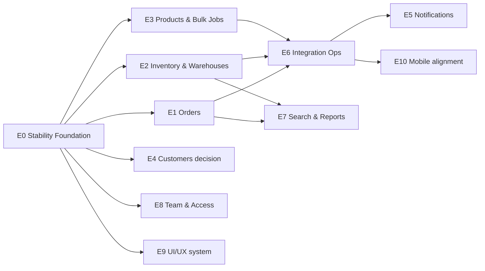
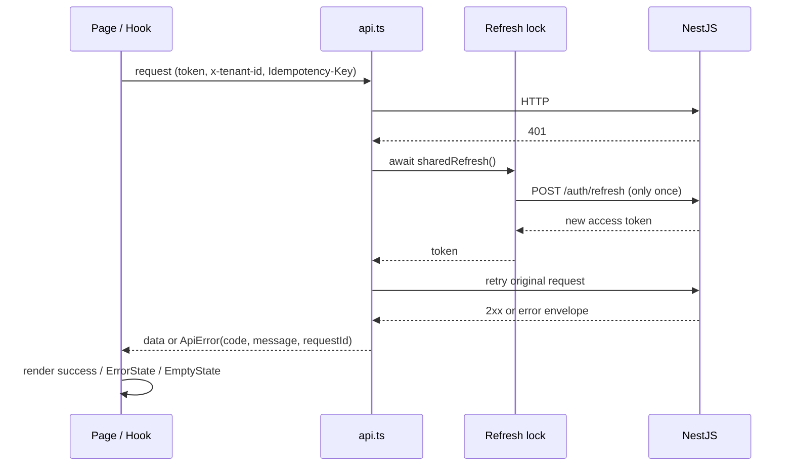
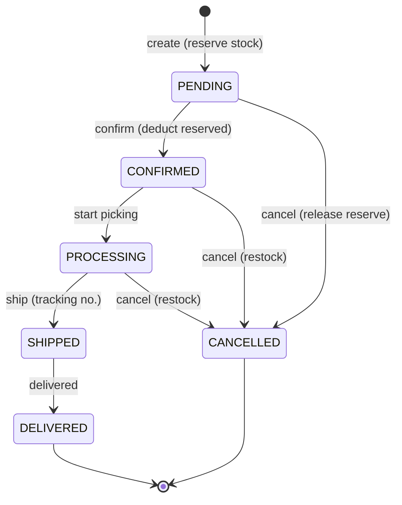
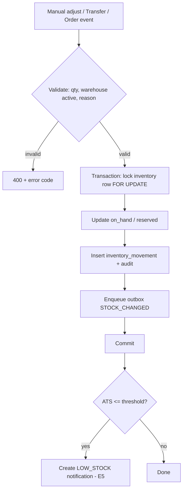
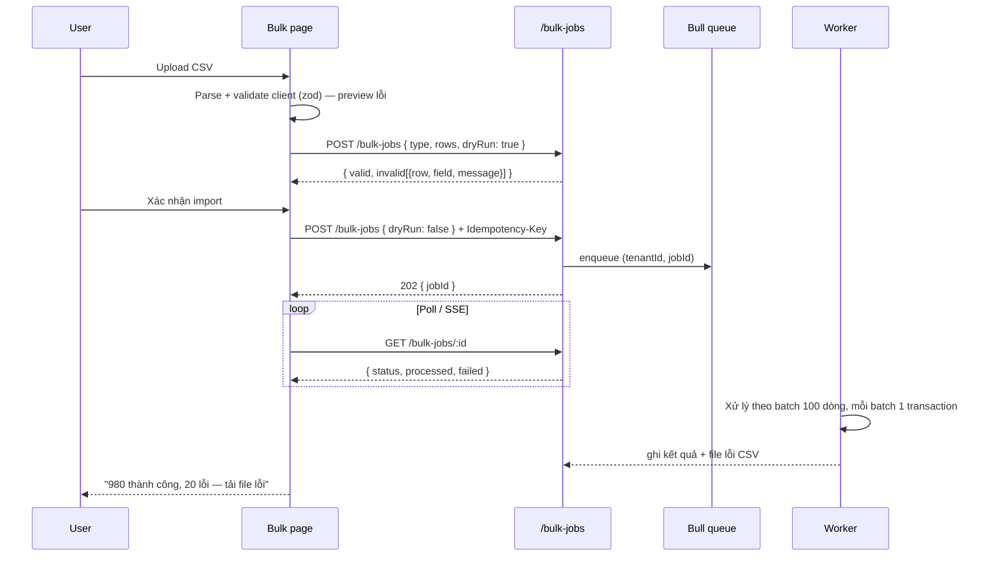
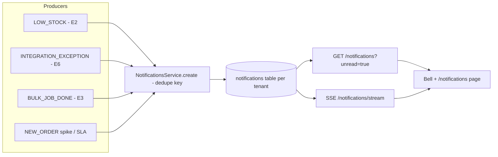
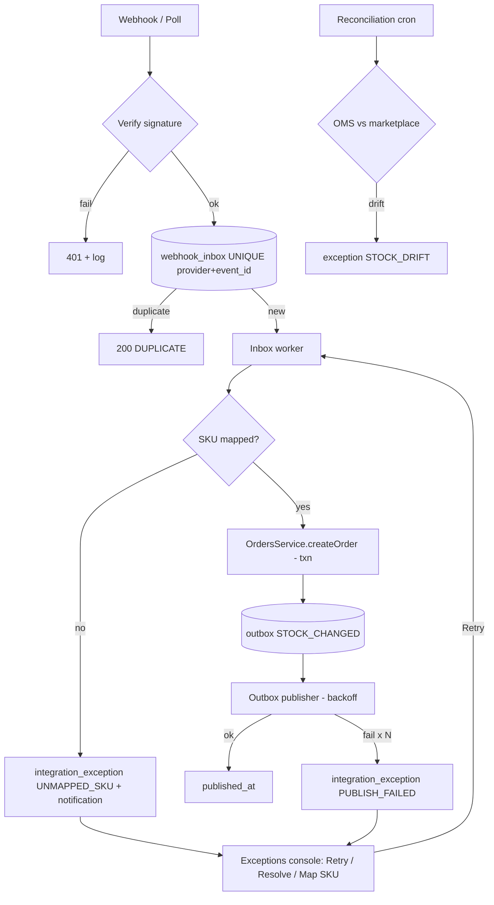

# Brainstorm & Plan: Hoàn thiện và mở rộng tính năng OMS

> Tài liệu **chỉ lập kế hoạch, chưa viết code**. Bổ sung cho [roadmap 09/10](saas-oms-feature-roadmap-research-2026-10-09.md): roadmap trả lời câu hỏi *làm sản phẩm gì*; tài liệu này trả lời *từng tính năng cần hoàn thiện ra sao, chạy theo workflow nào và làm sao để không crash*.

## 0. Tóm tắt

1. **Sau 09/10 đã xong:** tenant isolation (job IDOR, tenant suspended, cache SWR theo tenant) và self-service onboarding (commit `3dbeaed`, `44e7d09`).
2. **Vấn đề lớn nhất hiện tại:** nhiều màn hình **trông như đã hoạt động** nhưng thực ra gọi endpoint không tồn tại, dùng mock hoặc báo thành công giả (Customers, Notifications, Warehouses edit/delete, Bulk import, Bulk delete, Reports, Global Search). Đây là nguồn lỗi và mất niềm tin lớn nhất trước khi có beta.
3. **Khuyến nghị:** chạy **Stability Foundation (E0)** + **làm thật hoặc ẩn tính năng giả (E1–E4)** trước. Sau đó mới mở rộng **Integration Ops / connector thật (E6)** và các tính năng tăng giá trị (Notifications, Reports, Search).
4. **Định nghĩa "không crash"** trong tài liệu này: không trắng trang, không có unhandled rejection ở client hay server, không báo thành công giả, mọi lỗi đều có trạng thái UI để khôi phục, và mọi thao tác ghi đều idempotent hoặc an toàn khi retry.

---

## 1. Hiện trạng (bằng chứng từ repository)

### 1.1 Đã chắc chắn

| Khu vực | Hiện trạng | Bằng chứng |
|---|---|---|
| Order lõi | Tạo đơn, reserve stock, audit, outbox chạy trong một transaction; có state machine `PENDING→CONFIRMED→PROCESSING→SHIPPED→DELIVERED`, cho phép hủy | [orders.service.ts](../backend/src/orders/orders.service.ts) L48-55, L65-223 |
| Tồn kho | Có cột `reserved_quantity`, `safety_stock` và constraint toàn vẹn | [migration](../backend/src/database/migrations/1706606000000-AddInventoryIntegrityConstraints.ts) |
| Tenant | Membership + trạng thái tenant đã kiểm tra; SWR key chứa tenant | [jwt.strategy.ts](../backend/src/auth/jwt.strategy.ts), [useTenantScopedSWR.ts](../frontend/hooks/useTenantScopedSWR.ts) |
| Onboarding | Transaction tạo tenant + schema + owner | [tenants.service.ts](../backend/src/tenants/tenants.service.ts) |
| Bảo mật credential | Credential channel account đã được mã hóa; context của exception đã redact PII | [credential-cipher.service.ts](../backend/src/channel-accounts/credential-cipher.service.ts), [integration-operations.service.ts](../backend/src/integration-operations/integration-operations.service.ts) L231-257 |

### 1.2 Khoảng trống: tính năng hỏng hoặc giả

| # | Vấn đề | Hậu quả với người dùng | Bằng chứng |
|---|---|---|---|
| G1 | `useCustomers` gọi `fetch("/api/customers")` vào origin Next.js; **không có route handler Next và cũng không có module customers ở backend** | Trang Customers luôn lỗi; `res.json()` parse HTML 404 → SyntaxError; create/update không bao giờ thành công | [useCustomers.ts](../frontend/hooks/useCustomers.ts) L23-27, L54 |
| G2 | `useNotifications` có cùng mẫu lỗi với `/api/notifications` | Trang Notifications luôn lỗi | [useNotifications.ts](../frontend/hooks/useNotifications.ts) L21-47 |
| G3 | Frontend gọi `PUT/DELETE /warehouses/:id`, backend chỉ có `POST`, `GET`, `GET :id` | Sửa/xóa kho trả 404 | [useWarehouses.ts](../frontend/hooks/useWarehouses.ts) L60-65, [warehouses.controller.ts](../backend/src/warehouses/warehouses.controller.ts) |
| G4 | Trang chi tiết kho dùng mock data | Hiển thị số liệu sai | [warehouses/[id]/page.tsx](../frontend/app/warehouses/[id]/page.tsx) L21, L42 |
| G5 | Bulk import báo `toast.success` mà không gọi API | **Báo thành công giả**, người dùng tưởng dữ liệu đã nhập | [bulk-operations/page.tsx](../frontend/app/bulk-operations/page.tsx) L60-70 |
| G6 | Bulk delete product/customer báo thành công giả | Người dùng tưởng đã xóa | [products/page.tsx](../frontend/app/products/page.tsx) L74-86, [customers/page.tsx](../frontend/app/customers/page.tsx) L73 |
| G7 | Reports và Global Search dùng mock | Số liệu không có thật | [reports/page.tsx](../frontend/app/reports/page.tsx) L30, [GlobalSearch.tsx](../frontend/components/ui/GlobalSearch.tsx) L48-66 |
| G8 | Bộ lọc đơn `status`, `externalOrderId`, `channelAccountId` được gửi lên nhưng backend chỉ đọc `channel` | Lọc không có tác dụng, danh sách đơn sai | [useOrders.ts](../frontend/hooks/useOrders.ts) L17-26, [orders.controller.ts](../backend/src/orders/orders.controller.ts) L65-75 |
| G9 | Danh sách orders/products/inventory **không phân trang ở server**; client tự `slice` | Tenant có hàng nghìn bản ghi sẽ làm UI chậm hoặc treo; payload lớn | [orders.service.ts](../backend/src/orders/orders.service.ts) L225-238, [products/page.tsx](../frontend/app/products/page.tsx) L88-93 |
| G10 | Customer detail lấy **toàn bộ** orders, chưa lọc theo customer | Sai dữ liệu và tốn tải | [customers/[id]/page.tsx](../frontend/app/customers/[id]/page.tsx) L33 |
| G11 | Bulk print chỉ có toast "coming soon"; phân bổ tồn trên trang product detail cũng "coming soon" | Tính năng chưa có | [orders/page.tsx](../frontend/app/orders/page.tsx) L81, [products/[id]/page.tsx](../frontend/app/products/[id]/page.tsx) L148 |

### 1.3 Rủi ro gây crash hoặc mất ổn định

| # | Rủi ro | Bằng chứng |
|---|---|---|
| R1 | Không có `app/error.tsx`, `app/global-error.tsx`, `app/not-found.tsx`, `loading.tsx`; [ErrorBoundary.tsx](../frontend/components/ErrorBoundary.tsx) có nhưng **không được dùng** trong layout | `frontend/app/` chỉ có `layout.tsx`, `page.tsx` ở root; [layout.tsx](../frontend/app/layout.tsx) chỉ gắn `Toaster` |
| R2 | Refresh token chưa single-flight: nhiều request 401 đồng thời sẽ gọi `/auth/refresh` song song. Nếu refresh token rotation, request sau có thể fail và **đá người dùng ra login** | [api.ts](../frontend/lib/api.ts) L58-107 |
| R3 | Hai kiểu gọi API song song (`axios` có interceptor và `fetch` trần) → lỗi không nhất quán, thiếu header token/tenant | `useCustomers`, `useNotifications` |
| R4 | Chưa có rate limiting (không có `@nestjs/throttler`) cho login/register/refresh | [backend/package.json](../backend/package.json) |
| R5 | Chưa thấy `enableShutdownHooks()`; worker Bull có thể bị kill giữa chừng khi deploy | [main.ts](../backend/src/main.ts) |
| R6 | Retry exception chỉ đổi trạng thái `RETRYING`, chưa có worker xử lý lại; exception có thể kẹt mãi ở `RETRYING` | [integration-operations.service.ts](../backend/src/integration-operations/integration-operations.service.ts) L99-111 |
| R7 | Webhook đơn có SKU chưa map trả `skipped` nhưng **không tạo exception** → mất đơn mà không ai biết | [webhooks.service.ts](../backend/src/webhooks/webhooks.service.ts) L95-103 |
| R8 | Kiểm tra trùng webhook dựa trên `error.message.includes('already exists')`, dễ gãy nếu đổi message | [webhooks.service.ts](../backend/src/webhooks/webhooks.service.ts) L147 |
| R9 | Thư mục rỗng `frontend/app/auth`, `frontend/app/dashboard`; một số route (customers, notifications, reports, bulk-operations) không có trong Sidebar nhưng vẫn vào được bằng URL | [Sidebar.tsx](../frontend/components/layout/Sidebar.tsx) L27-39 |
| R10 | Test: backend chủ yếu là unit test, e2e chỉ có [app.e2e-spec.ts](../backend/test/app.e2e-spec.ts); frontend có 5 file test cho `lib/`, chưa có test cho component/page | `frontend/lib/*.test.ts` |
| R11 | Invite chưa gửi email; `fullName` của member đang lấy từ email | [tenant-members.service.ts](../backend/src/tenants/tenant-members.service.ts) L40, L120 |

---

## 2. 🧠 Brainstorm: Chọn chiến lược enhance

### Option A — "Honest Product" trước (Stabilize → Complete → Extend)
Sửa nền tảng chống crash, làm thật hoặc ẩn mọi tính năng giả, sau đó mới thêm tính năng mới.

✅ **Ưu điểm:** Loại bỏ ngay nguồn lỗi lớn nhất; mỗi màn hình hiển thị đều đáng tin; nền tảng (pagination, error envelope, bulk job) tái sử dụng được cho mọi feature sau.
❌ **Nhược điểm:** 2–3 tuần đầu ít "tính năng mới" để demo.
📊 **Effort:** Medium

### Option B — Feature-first (thêm Notifications, Reports, Customers... ngay)
✅ **Ưu điểm:** Demo nhanh, nhiều màn hình.
❌ **Nhược điểm:** Xây trên nền chưa có pagination, error boundary hay contract chuẩn → nợ kỹ thuật nhân lên; dễ crash khi dữ liệu lớn.
📊 **Effort:** High (và tăng dần do phải làm lại)

### Option C — Connector-first (dồn lực cho Shopee thật + inbox/outbox)
✅ **Ưu điểm:** Đúng giá trị cốt lõi ("không mất đơn").
❌ **Nhược điểm:** Bị chặn bởi quyền Shopee Partner API (chưa xác minh); UI vẫn còn tính năng giả trong lúc chờ.
📊 **Effort:** High, và rủi ro phụ thuộc bên ngoài

### 💡 Khuyến nghị
**Option A, sau đó chuyển sang C.** Làm E0–E4 trong lúc chờ quyền API. Phần inbox/outbox worker và luồng "unmapped SKU → exception" (E6) có thể làm song song với fixture/contract test, nên không bị chặn bởi Shopee.

---

## 3. Nguyên tắc chống crash (áp dụng cho mọi feature)

### 3.1 Backend (NestJS)

| Nguyên tắc | Cách làm cụ thể |
|---|---|
| **Một error envelope chuẩn** | `{ statusCode, code, message, details?, requestId }`; `code` dạng máy đọc được (`ORDER_DUPLICATE`, `STOCK_INSUFFICIENT`). Mở rộng [http-exception.filter.ts](../backend/src/common/filters/http-exception.filter.ts), không so sánh `error.message` (sửa R8) |
| **Validate ở biên** | DTO + `class-validator` cho body/query/param; `ParseUUIDPipe` cho `:id` để tránh lỗi Postgres `invalid input syntax for uuid` bị trả thành 500 |
| **Phân trang bắt buộc** | Mọi endpoint list có `limit` (mặc định 25, tối đa 100) + cursor hoặc `page`; trả `{ data, meta: { total?, nextCursor? } }` |
| **Transaction + idempotency** | Thao tác ghi quan trọng nhận header `Idempotency-Key` (frontend đã có [idempotency.ts](../frontend/lib/idempotency.ts)); lưu key + response trong 24 giờ |
| **Không để exception thoát khỏi worker** | Processor bắt lỗi, phân loại `retryable` hoặc `permanent`, dùng backoff có giới hạn; khi hết lượt retry thì tạo `integration_exception` |
| **Graceful shutdown** | `app.enableShutdownHooks()`; đóng queue và DB pool; `/health/ready` trả 503 khi đang drain |
| **Rate limiting** | `@nestjs/throttler`: auth 5 lần/phút/IP, API chung 100 lần/phút/user, webhook theo account |
| **Bảo vệ DB** | `statement_timeout` (vd. 5s) cho request API; index cho các cột lọc/sort mới |
| **Observability** | `requestId` xuyên suốt (đã có [request-context.middleware.ts](../backend/src/common/middleware/request-context.middleware.ts)); log JSON có `tenantId`, `userId`, `durationMs` |

### 3.2 Frontend (Next.js + SWR)

| Nguyên tắc | Cách làm cụ thể |
|---|---|
| **Error boundary nhiều tầng** | `app/global-error.tsx` (lỗi root layout), `app/error.tsx` (lỗi route, có nút "Thử lại"), `not-found.tsx`; bọc widget nguy hiểm (chart, print) bằng `ErrorBoundary` cục bộ |
| **Một API client duy nhất** | Xóa `fetch` trần; mọi hook đi qua `api.ts` + `useTenantScopedSWR`; chuẩn hóa lỗi qua [api-error.ts](../frontend/lib/api-error.ts) |
| **Refresh single-flight** | Giữ một promise refresh dùng chung; request 401 xếp hàng chờ promise đó; refresh lỗi → logout một lần (sửa R2) |
| **4 trạng thái bắt buộc** | Mỗi màn hình dữ liệu đều có `loading` (Skeleton), `error` (ErrorState + retry), `empty` (EmptyState + CTA) và `success` |
| **Không báo thành công giả** | Chỉ `toast.success` sau khi API trả 2xx. Tính năng chưa có backend thì **ẩn** hoặc gắn badge "Sắp có" và disable nút |
| **Chống double-submit** | Disable nút khi đang gửi; gửi `Idempotency-Key` cho create/bulk |
| **Phòng thủ dữ liệu** | Optional chaining cho dữ liệu từ API; parse response bằng `zod` (đã có trong deps) ở các hook quan trọng (orders, inventory) |
| **URL là nguồn sự thật cho filter** | Filter/pagination nằm trên query string → reload không mất state, chia sẻ link được |

---

## 4. Epics, workflow và tiêu chí hoàn thành

Mỗi epic có: **Mục tiêu → Workflow → Backend → Frontend → Chống crash → Test → Done khi**.

### E0. Stability Foundation — P0 · Effort M · ~1–1,5 tuần

**Mục tiêu:** Mọi lỗi đều có chỗ "rơi" an toàn; contract API thống nhất.

| Hạng mục | Việc cần làm |
|---|---|
| Backend | Error envelope + error codes; `ParseUUIDPipe`; helper `PaginationQueryDto` + `Paginated<T>`; throttler; `enableShutdownHooks`; `statement_timeout` |
| Frontend | `error.tsx`, `global-error.tsx`, `not-found.tsx`, `loading.tsx`; refresh single-flight; xóa `fetch` trần; hook `usePaginatedQuery` đồng bộ URL; xóa thư mục rỗng `app/auth`, `app/dashboard` |
| Feature flag | Tạo `lib/features.ts` (cờ tĩnh theo env) để ẩn route/nút chưa hoàn thiện, gồm cả truy cập trực tiếp qua URL |
| Test | Unit cho refresh lock (3 request 401 đồng thời → chỉ 1 lần refresh); e2e cho error envelope (UUID sai → 400, không phải 500) |

**Done khi:** ném lỗi giả lập trong một page không làm trắng toàn app; UUID sai trả 400; 3 request 401 song song chỉ gọi 1 lần refresh.

---

### E1. Orders hoàn chỉnh — P0 · Effort M–L · ~1,5–2 tuần

**Mục tiêu:** Danh sách đơn lọc đúng, xử lý đúng state machine, có thao tác hàng loạt thật.

| Hạng mục | Việc cần làm |
|---|---|
| Backend | `GET /orders` hỗ trợ `status`, `channel`, `channelAccountId`, `q` (order number / external id / tên khách), `from`, `to`, `sort`, phân trang; index `(status, created_at)`, `(external_order_id)` |
| | `GET /orders/:id/timeline` lấy từ `audit_logs` + `inventory_movements` |
| | `GET /orders/:id/allowed-transitions` (hoặc trả trong response chi tiết) để UI không phải tự đoán state machine |
| | `POST /orders/bulk-status` nhận `{ ids[], status, reason? }`, xử lý **từng đơn trong transaction riêng**, trả `{ succeeded[], failed[{id, code, message}] }`; không để 1 đơn lỗi làm hỏng cả lô |
| | Bổ sung `cancel_reason`, `tracking_number`, `carrier` (migration) |
| Frontend | Filter bar đồng bộ URL; server pagination; nút chuyển trạng thái chỉ hiển thị các transition hợp lệ; confirm modal khi hủy (bắt buộc nhập lý do) |
| | Bulk action bar gọi `bulk-status`, sau đó hiển thị kết quả từng phần ("8 thành công, 2 lỗi: …") |
| | Bulk print: gom packing slip nhiều đơn vào một PDF ([PackingSlip.tsx](../frontend/components/print/PackingSlip.tsx) đã có), giới hạn 50 đơn/lần |
| | Timeline trên trang chi tiết đơn |
| Chống crash | Optimistic update có rollback khi API lỗi; 409 (state đã đổi bởi người khác) → refetch + toast giải thích |
| Test | Unit: mọi cặp transition (hợp lệ/không hợp lệ) với tồn kho đúng; integration: bulk 10 đơn trong đó 2 đơn sai trạng thái; e2e Playwright: lọc → chọn → confirm hàng loạt |

**Done khi:** mọi bộ lọc trên UI đều có tác dụng ở server; danh sách 10.000 đơn vẫn mượt (p95 API < 300ms trên dữ liệu seed); bulk action không bao giờ báo thành công cho đơn bị lỗi.

---

### E2. Inventory & Warehouses — P0 · Effort M · ~1,5 tuần

**Mục tiêu:** Kho đầy đủ CRUD; người dùng hiểu chính xác vì sao một SKU còn bán được bao nhiêu.

**Công thức hiển thị (đã có cột trong DB):**
`ATS (Available To Sell) = on_hand − reserved_quantity − safety_stock` (không âm)

| Hạng mục | Việc cần làm |
|---|---|
| Backend | Thêm `PUT /warehouses/:id`, `DELETE /warehouses/:id` (soft delete; **chặn xóa** khi kho còn tồn hoặc còn đơn chưa hoàn tất → 409 `WAREHOUSE_IN_USE`) — sửa G3 |
| | `GET /warehouses/:id/summary` (tổng SKU, tổng on-hand, giá trị tồn) — sửa mock G4 |
| | `POST /inventory/transfer` (kho A → B, một transaction, hai movement) |
| | `GET /inventory/movements?masterSkuId=&warehouseId=` (ledger có phân trang) |
| | `GET /inventory` có phân trang, lọc `lowStock=true`, `warehouseId`; trả kèm `ats` |
| | Cấu hình `safety_stock` theo SKU/kho |
| Frontend | Trang kho chi tiết dùng dữ liệu thật; tab "Movements" (ledger); modal Transfer; cột ATS + tooltip giải thích công thức; trang product detail hiển thị phân bổ tồn theo kho (thay "coming soon") |
| Chống crash | Adjust âm vượt tồn → lỗi 409 `STOCK_INSUFFICIENT` có message rõ ràng; double-click adjust bị chặn nhờ idempotency key |
| Test | Concurrency test: 20 lệnh reserve song song cho SKU còn 10 → đúng 10 thành công; transfer rollback khi kho đích inactive |

**Done khi:** Warehouses CRUD chạy đầu-cuối; ATS khớp với ledger; không còn mock ở warehouse/product detail.

---

### E3. Products & Bulk Jobs (Import/Export/Delete) — P1 · Effort M–L · ~2 tuần

**Mục tiêu:** Nhập/xóa hàng loạt chạy thật, có báo cáo lỗi từng dòng và chạy nền.

| Hạng mục | Việc cần làm |
|---|---|
| Backend | Bảng `bulk_jobs` (tenant schema): `type`, `status`, `total`, `processed`, `failed`, `error_report`; endpoint `POST /bulk-jobs`, `GET /bulk-jobs/:id`, `GET /bulk-jobs/:id/errors.csv` |
| | Loại job: `PRODUCT_IMPORT` (upsert theo SKU), `INVENTORY_IMPORT` (đặt tồn theo SKU+kho), `PRODUCT_DELETE` (soft delete; chặn SKU còn reserved) |
| | Giới hạn: tối đa 5.000 dòng/job, 5MB; kiểm quota gói qua [tenant-limits.service.ts](../backend/src/tenants/tenant-limits.service.ts) |
| Frontend | Wizard 3 bước: Upload → Preview (dòng lỗi được tô đỏ) → Progress → Kết quả; thay `toast.success` giả (G5, G6) |
| Chống crash | Parse CSV chạy trong Web Worker hoặc theo chunk để không treo tab; worker idempotent theo `(jobId, rowNumber)`; job kẹt quá 15 phút → `FAILED` + exception |
| Test | File có BOM/UTF-8 tiếng Việt, dòng trống, SKU trùng trong file, cột thiếu; job chạy lại sau khi worker restart không tạo bản ghi trùng |

**Done khi:** import 5.000 dòng không treo UI; mọi dòng lỗi đều có lý do; không còn TODO bulk trong `products`, `customers`, `bulk-operations`.

---

### E4. Customers — P1 · Effort S (ẩn) hoặc M (làm thật)

**Brainstorm nhanh:**

| Phương án | Mô tả | Khi nào chọn |
|---|---|---|
| **4A. Ẩn tạm** | Đưa route vào feature flag, gỡ hook `/api/customers` | Pilot chưa cần CRM |
| **4B. Customer suy ra từ đơn** (khuyến nghị) | Bảng `customers` upsert từ đơn (khóa: `channel + buyer id`, hoặc `phone` đã chuẩn hóa); read-only + ghi chú | Cần xem lịch sử mua và khách quay lại |
| 4C. CRM đầy đủ | Tag, segment, campaign | Để sau, khi có tín hiệu nhu cầu |

**Workflow 4B:** order created → upsert customer trong cùng transaction → `orders.customer_id` → `GET /customers?q=&page=`, `GET /customers/:id`, `GET /orders?customerId=` (sửa G10).

**Lưu ý dữ liệu:** phone/địa chỉ là PII → che một phần trên UI, chỉ role phù hợp mới xem đầy đủ, và giữ redact trong log.

---

### E5. Notifications in-app — P1 · Effort M · ~1 tuần

| Hạng mục | Việc cần làm |
|---|---|
| Backend | Bảng `notifications` (`type`, `severity`, `title`, `body`, `link`, `dedupe_key`, `read_at`, `user_id` nullable = toàn tenant); `GET /notifications`, `POST /notifications/:id/read`, `POST /notifications/read-all` |
| Realtime | **Bắt đầu bằng polling SWR 30s** (đơn giản, đủ ổn định); nâng lên SSE khi cần. `socket.io-client` đã có trong deps nhưng backend chưa có gateway → cân nhắc gỡ nếu chọn SSE |
| Chống spam | `dedupe_key` (vd. `LOW_STOCK:{sku}:{warehouse}:{date}`) + unique index |
| Frontend | Hook mới dùng `api.ts` (sửa G2); badge số chưa đọc; đánh dấu đã đọc dùng optimistic update |

**Done khi:** low stock và exception mới đều sinh notification đúng 1 lần; trang Notifications không còn lỗi.

---

### E6. Integration Ops (Inbox/Outbox, Retry thật, Reconciliation) — P0/P1 · Effort L · ~2–3 tuần

**Mục tiêu:** "Không mất đơn và biết vì sao lệch tồn". Phần lớn epic này làm được với fixture, chưa cần Shopee thật.

| Hạng mục | Việc cần làm |
|---|---|
| Backend | Inbox worker đọc `webhook_inbox` theo `FOR UPDATE SKIP LOCKED`; outbox publisher có backoff (1m, 5m, 30m, 2h) và trạng thái `DEAD` |
| | Webhook unmapped SKU → tạo exception `UNMAPPED_SKU` kèm payload (đã redact) — sửa R7 |
| | **Retry thật:** `POST /integration-exceptions/:id/retry` đẩy lại sự kiện gốc vào queue; worker thành công → `RESOLVED`, thất bại → `OPEN` + `retry_count++` — sửa R6 |
| | Hành động "Map SKU ngay" trong exception → tạo mapping rồi tự retry |
| | Reconciliation giữ `BLOCKED_CONTRACT` cho tới khi có contract; viết adapter interface + fake adapter cho test |
| Frontend | Exceptions console: lọc theo loại/mức độ/tuổi, xem payload, Retry/Resolve/Map SKU, lịch sử retry; Channels: health theo account (lag, lần sync cuối, số lỗi 24h) |
| Chống crash | Worker không bao giờ throw ra ngoài vòng lặp; mỗi message có timeout; poison message → `DEAD` thay vì retry vô hạn |
| Test | Contract test bằng fixture: webhook trùng, sai thứ tự, thiếu mapping, publisher lỗi 3 lần rồi thành công |

**Done khi:** không còn đơn nào bị "skipped" âm thầm; mọi exception đều có đường xử lý trên UI; retry thật sự chạy lại tác vụ.

---

### E7. Global Search & Reports thật — P2 · Effort M · ~1,5 tuần

| Hạng mục | Việc cần làm |
|---|---|
| Search | `GET /search?q=&types=orders,products,customers` — `ILIKE` + index `pg_trgm` (migration `EnableExtensions` hiện chỉ bật `pgcrypto`, `uuid-ossp` → cần migration mới bật `pg_trgm`); giới hạn 5 kết quả/loại; debounce 300ms + hủy request cũ (`AbortController`) — sửa G7 |
| Reports | `GET /reports/sales?from&to&groupBy=day\|channel`, `/reports/inventory-value`, `/reports/top-skus`; tính bằng SQL aggregate, cache 5 phút theo `(tenant, params)`; giới hạn khoảng ngày ≤ 366 ngày |
| Export | Export CSV chạy server-side cho dữ liệu lớn (tái dùng bulk job), client-side chỉ cho trang hiện tại |
| Chống crash | Chart có ErrorBoundary riêng; dữ liệu rỗng → EmptyState thay vì chart lỗi; range ngày không hợp lệ bị chặn ở UI và DTO |

**Done khi:** không còn mock trong `reports/page.tsx` và `GlobalSearch.tsx`.

---

### E8. Team & Access — P1 · Effort S–M

- Gửi email invite (provider qua env, vd. SMTP/Resend); link có token hết hạn 7 ngày; trang `/invites/accept` (backend đã có `POST /invites/accept`).
- Thêm `fullName` vào User (migration) — sửa TODO R11.
- **Role-aware UI:** hook `usePermission(action)` dựa trên role từ `/auth/profile`; ẩn/disable nút theo role (Sales Staff không adjust tồn). Backend vẫn là nơi quyết định cuối cùng qua `RolesGuard`.
- Audit: hiển thị "ai làm gì" trên Activity, lọc theo user/entity.

---

### E9. UI/UX System — P1 (chạy xuyên suốt) · Effort M

Kết quả `ui-ux-pro-max` cho "B2B SaaS order management operations dashboard": **Data-Dense + Drill-Down**, phong cách *Data-Dense Dashboard*, WCAG AA.

| Token | Đề xuất | Ghi chú |
|---|---|---|
| Primary / Text | `#0F172A` / `#020617` | Slate đậm, hợp với dashboard vận hành |
| Secondary | `#334155` | |
| CTA | `#0369A1` | Xanh chuyên nghiệp; tránh tím (theo quy ước dự án) |
| Background | `#F8FAFC` | + dark mode dùng biến CSS |
| Font | Fira Sans (body), Fira Code (số liệu, SKU, mã đơn) | Số dùng `tabular-nums` để cột thẳng hàng |

**Việc cần làm:**
- Hợp nhất token giữa Tailwind ([tailwind.config.ts](../frontend/tailwind.config.ts)) và antd ([AntdConfigProvider.tsx](../frontend/components/providers/AntdConfigProvider.tsx)) để không lệch màu.
- Chuẩn hóa `Table`: sticky header, row hover, chọn nhiều dòng bằng Shift, density toggle (compact/comfortable), virtualize khi > 200 dòng.
- Status badge: màu **+ icon + text** (không chỉ dựa vào màu).
- Trạng thái lỗi/rỗng/loading dùng chung component [ErrorState](../frontend/components/ui/ErrorState.tsx), [EmptyState](../frontend/components/ui/EmptyState.tsx), [Skeleton](../frontend/components/ui/Skeleton.tsx).
- Keyboard: `/` focus search, `g o` tới Orders ([KeyboardShortcutsModal](../frontend/components/ui/KeyboardShortcutsModal.tsx) đã có); focus ring rõ ràng.
- Responsive 375/768/1024/1440; bảng trên mobile chuyển sang card list.
- `prefers-reduced-motion`; transition 150–250ms; không dùng emoji làm icon (dùng Lucide).

---

### E10. Mobile alignment — P2 · Effort M

- Dùng chung contract (error envelope, pagination) với web; xử lý refresh single-flight trong [mobile/src/services/api.ts](../mobile/src/services/api.ts).
- Phạm vi pilot: xem đơn, đổi trạng thái theo `allowed-transitions` (thay validation tự viết trong [orderStatusValidation.ts](../mobile/src/utils/orderStatusValidation.ts)), quét barcode để pick/pack (tùy nhu cầu pilot).
- Offline: chỉ cache đọc; thao tác ghi yêu cầu online + idempotency key.

---

## 5. Lộ trình đề xuất

*Giả định: 1–2 kỹ sư full-stack. Mỗi slice là một PR nhỏ, có test và có thể rollback.*

| Sprint | Nội dung | Ưu tiên | Kết quả kiểm chứng được |
|---|---|---|---|
| **S1** (tuần 1–2) | E0 toàn bộ + ẩn feature flag cho Customers/Notifications/Reports/Search/Bulk + sửa G3 Warehouses PUT/DELETE + G8 filter orders | P0 | Không còn tính năng giả hiển thị; không trắng trang |
| **S2** (tuần 3–4) | E1 Orders (pagination, bulk-status, timeline, bulk print) + E2 phần ATS, ledger, transfer | P0 | Bảng đơn 10k bản ghi mượt; bulk có báo cáo từng phần |
| **S3** (tuần 5–6) | E6 inbox/outbox worker + retry thật + unmapped SKU exception (bằng fixture) + E8 invite email | P0/P1 | Không còn đơn bị skip âm thầm |
| **S4** (tuần 7–8) | E3 Bulk jobs + E5 Notifications (polling) + E4B Customers | P1 | Import 5k dòng; low stock tạo notification |
| **S5** (tuần 9–10) | E7 Search/Reports + E9 polish + E10 mobile alignment | P2 | Không còn mock trong frontend |

> Nếu có quyền Shopee Partner API trong lúc làm, chèn connector thật vào sau S3 theo [implementation-plan-production-pilot.md](implementation-plan-production-pilot.md) Phase 3 và lùi S5.

---

## 6. Chiến lược test và quality gates

### 6.1 Test pyramid

| Tầng | Công cụ | Tập trung vào |
|---|---|---|
| Unit | Jest (BE), Vitest (FE) | State machine, tính ATS, error mapping, refresh lock, parse CSV |
| Integration | Jest + Postgres thật (Testcontainers hoặc docker compose) | Transaction, concurrency reserve, cô lập tenant, worker idempotent |
| Contract | Fixture marketplace | Webhook trùng/sai thứ tự/thiếu mapping |
| E2E | Playwright | 5 luồng chính: login → tạo store; tạo đơn → confirm → ship; adjust/transfer tồn; bulk import; xử lý exception |
| Chaos nhẹ | Script | Kill worker giữa job; API trả 500/timeout ngẫu nhiên → UI vẫn có ErrorState |

### 6.2 Merge gate (mỗi PR)

- [ ] `npm run lint` + `tsc --noEmit` cho phần đã sửa
- [ ] `npm test` backend + `npm test` frontend xanh
- [ ] Endpoint mới có DTO validation + test 400/403/404/409
- [ ] Màn hình mới có đủ 4 trạng thái loading/error/empty/success
- [ ] Không còn `TODO` dẫn tới thành công giả; không có `fetch` trần ngoài `api.ts`
- [ ] Thao tác ghi có idempotency hoặc giải thích vì sao không cần

### 6.3 Definition of Done "không crash" cho từng feature

1. Ném lỗi trong component → chỉ vùng đó hiển thị fallback, app vẫn điều hướng được.
2. API trả 500/timeout → có ErrorState + nút thử lại, không có unhandled promise rejection trong console.
3. Dữ liệu rỗng / `null` / mảng lớn (≥ 10k) → không lỗi render, không treo tab.
4. Double-click / submit lặp → không tạo bản ghi trùng.
5. Đổi tenant giữa lúc request đang chạy → không hiển thị dữ liệu tenant cũ.
6. Token hết hạn giữa chừng → tự refresh một lần, không đá người dùng ra ngoài.
7. Worker restart giữa job → job tiếp tục hoặc fail có lý do, không trùng dữ liệu.

---

## 7. Rủi ro và giảm thiểu

| Rủi ro | Mức | Giảm thiểu |
|---|---|---|
| Thay đổi contract `GET /orders` (mảng → `{data, meta}`) làm vỡ web/mobile | Cao | Version hóa bằng query `?paginated=1` trong giai đoạn chuyển tiếp, hoặc cập nhật web và mobile trong cùng release |
| Migration trên nhiều schema tenant | Cao | Dùng cơ chế sync schema hiện có; test schema mới so với schema đã migrate; chạy migration theo batch tenant |
| Worker xử lý trùng khi scale nhiều instance | Trung bình | `SKIP LOCKED` + unique idempotency key |
| Feature flag che lỗi lâu dài | Trung bình | Mỗi flag có owner + hạn gỡ trong backlog |
| Email invite bị spam/abuse | Thấp | Rate limit theo tenant; token một lần dùng |

---

## 8. Câu hỏi cần chốt (cần bạn quyết định)

1. **Customers:** ẩn tạm (4A) hay làm bản suy ra từ đơn (4B) -> làm bản suy ra giúp mình nhé
2. **Realtime notifications:** polling 30s là đủ cho pilot, hay cần SSE ngay? Có giữ `socket.io-client` không? polling 30s
3. **Contract pagination:** chấp nhận breaking change `GET /orders` → `{ data, meta }` và cập nhật mobile cùng lúc không? có
4. **Fulfillment trong OMS:** pilot có cần `tracking_number`/carrier và pick-pack (ảnh hưởng E1, E10) hay chỉ theo dõi trạng thái từ marketplace? Chỉ theo dõi trạng thái từ marketplace
5. **Email provider** cho invite (SMTP nội bộ, Resend, SES…)? resend
6. **Ưu tiên giữa S3 và S4:** nếu quyền Shopee API đến sớm, có chấp nhận lùi Bulk/Notifications không? không lùi 

---

## 9. Phạm vi và giới hạn của tài liệu

- Dựa trên đọc mã nguồn tại commit `82254fb` và các tài liệu trong `docs/`. **Chưa chạy** app hay test suite trong phiên này; các nhận định "luôn lỗi" ở G1–G3 suy ra từ việc endpoint không tồn tại, chưa tái hiện trên trình duyệt.
- Phiên này không có MCP Firecrawl/Exa nên không thực hiện deep-research web mới; phần bối cảnh thị trường và API marketplace tham chiếu [roadmap 09/10](saas-oms-feature-roadmap-research-2026-10-09.md) (đã có nguồn AWS, Shopify, TikTok Shop, PostgreSQL).
- Ước lượng effort là tương đối, chưa phải cam kết.
